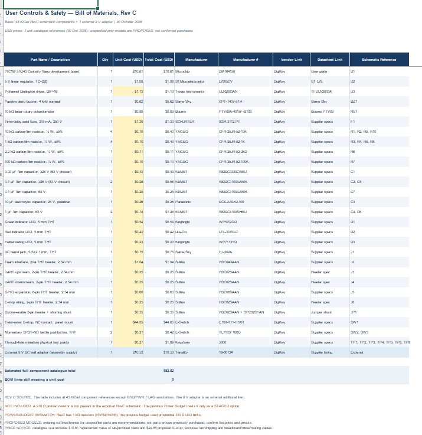

# User Controls & Safety — Bill of Materials (Rev C)

## Overview

The BOM below was prepared from the **RevC KiCad schematic (30 October 2026)** for the PIC18F57Q43 User Controls & Safety subsystem. It includes all **43 non-power schematic symbols** (excluding GND and PWR_FLAG) plus the previously selected external 9 V wall adapter. Components with unspecified orderable part numbers and prices remain **TBD** pending physical assembly decisions.

[Download editable BOM Excel](EGR304_BOM_RevC.xlsx) · [View KiCad RevC source](https://github.com/idtrfmnhcw/idtrfmnhcw_EGR304_F26.github.io/blob/main/docs/04-Schematic/EGR304_User_Controls_Project_RevC.zip)

## Part 1 — Bill of Materials (Table)

*Table 1. Revision C grouped component list. Prices shown are historical reference quotes from Component Selection, not verified live purchasing prices.*

| Part Name / Description | Qty | Unit Cost (USD) | Total Cost (USD) | Manufacturer | Manufacturer # | Vendor Link | Datasheet Link | Schematic Reference Designators |
|:--|--:|--:|--:|:--|:--|:--|:--|:--|
| PIC18F57Q43 Curiosity Nano development board | 1 | TBD | TBD | Microchip | DM164150 | [Microchip](https://www.microchip.com/en-us/development-tool/DM164150) | [User guide](https://ww1.microchip.com/downloads/en/DeviceDoc/PIC18F57Q43-Curiosity-Nano-HW-UserGuide-DS40002186B.pdf) | U1 |
| 5 V linear regulator, TO-220 | 1 | $1.08 | $1.08 | STMicroelectronics | L7805CV | [DigiKey](https://www.digikey.com/en/products/detail/stmicroelectronics/L7805CV/585964) | [ST L78](https://www.st.com/resource/en/datasheet/l78.pdf) | U2 |
| 7-channel Darlington driver, DIP-16 | 1 | TBD | TBD | Texas Instruments | ULN2003AN (verify) | TBD | [TI ULN2003A](https://www.ti.com/lit/ds/symlink/uln2003a.pdf) | U3 |
| Passive piezo buzzer, 4 kHz nominal | 1 | $0.62 | $0.62 | Same Sky | CPT-1407-5TH | [DigiKey](https://www.digikey.com/en/products/detail/same-sky-formerly-cui-devices/CPT-1407-5TH/29292280) | [Same Sky](https://www.sameskydevices.com/product/resource/cpt-1407-5th.pdf) | BZ1 |
| 10 kΩ linear rotary potentiometer | 1 | $0.89 | $0.89 | Bourns | PTV09A-4015F-B103 | [DigiKey](https://www.digikey.com/en/products/detail/bourns-inc/PTV09A-4015F-B103/3781113) | [Bourns PTV09](https://www.bourns.com/docs/product-datasheets/PTV09.pdf) | RV1 |
| Time-delay fuse, T315 mA (provisional) | 1 | TBD | TBD | TBD | TBD | TBD | TBD | F1 |
| 10 kΩ resistor; tolerance/size TBD | 4 | TBD | TBD | TBD | TBD | TBD | TBD | R1, R2, R9, R10 |
| 1 kΩ resistor; tolerance/size TBD | 4 | TBD | TBD | TBD | TBD | TBD | TBD | R3, R4, R5, R8 |
| 2.2 kΩ resistor; tolerance/size TBD | 1 | TBD | TBD | TBD | TBD | TBD | TBD | R6 |
| 100 kΩ resistor; tolerance/size TBD | 1 | TBD | TBD | TBD | TBD | TBD | TBD | R7 |
| 0.33 µF capacitor, 25 V | 1 | TBD | TBD | TBD | TBD | TBD | TBD | C1 |
| 0.1 µF capacitor, 25 V | 2 | TBD | TBD | TBD | TBD | TBD | TBD | C2, C5 |
| 0.1 µF capacitor, 63 V | 1 | TBD | TBD | TBD | TBD | TBD | TBD | C7 |
| 10 µF capacitor, 25 V | 1 | TBD | TBD | TBD | TBD | TBD | TBD | C3 |
| 1 µF capacitor, 63 V | 2 | TBD | TBD | TBD | TBD | TBD | TBD | C4, C6 |
| Green indicator LED | 1 | TBD | TBD | TBD | TBD | TBD | TBD | D1 |
| Red indicator LED | 1 | TBD | TBD | TBD | TBD | TBD | TBD | D2 |
| Debug indicator LED | 1 | TBD | TBD | TBD | TBD | TBD | TBD | D3 |
| DC barrel jack, matching 5.5×2.1 mm adapter | 1 | TBD | TBD | TBD | TBD | TBD | TBD | J1 |
| Team interface, 2×4 pin connector | 1 | TBD | TBD | TBD | TBD | TBD | TBD | J2 |
| UART upstream, 2-pin connector | 1 | TBD | TBD | TBD | TBD | TBD | TBD | J3 |
| UART downstream, 2-pin connector | 1 | TBD | TBD | TBD | TBD | TBD | TBD | J4 |
| GPIO expansion, 6-pin connector | 1 | TBD | TBD | TBD | TBD | TBD | TBD | J5 |
| E-stop external wiring, 2-pin connector | 1 | TBD | TBD | TBD | TBD | TBD | TBD | J6 |
| Two-pin buzzer-enable jumper/header | 1 | TBD | TBD | TBD | TBD | TBD | TBD | JP1 |
| Normally closed emergency-stop switch | 1 | TBD | TBD | TBD | TBD | TBD | TBD | SW1 |
| Momentary pushbutton switch | 2 | TBD | TBD | TBD | TBD | TBD | TBD | SW2, SW3 |
| Schematic test-point locations | 7 | TBD | TBD | TBD | TBD | TBD | TBD | TP1, TP2, TP3, TP4, TP5, TP6, TP8 |
| External 9 V DC wall adapter (assembly supply) | 1 | $10.53 | $10.53 | Tensility | 16-00134 | [DigiKey](https://www.digikey.com/en/products/detail/tensility-international-corp/16-00134/10324425) | [Supplier listing](https://www.digikey.com/en/products/detail/tensility-international-corp/16-00134/10324425) | External |

**Known-price subtotal (incomplete): $13.12.** **25 of 29 lines** still need verified unit prices, so a full BOM total is not yet available. Missing prices are not treated as zero.

## Part 2 — Bill of Materials (Image)

*Figure 1. Image view of the same RevC BOM. The editable spreadsheet and table above remain the authoritative reference if prices or parts change.*

## Design checks before ordering

1. **ULN2003A replaces the original 2N3904.** RevC has U3 = ULN2003A with a DIP-16 footprint. Verify the exact DIP-16 manufacturer order code (e.g., whether ULN2003AN will be used).
2. **910 Ω preload is not in the RevC schematic.** The separate Power Budget includes it as a *staged* assumption only; add it to KiCad and this BOM if the design needs it.
3. **Resistor mismatch:** RevC includes 1 kΩ resistors at R3, R4, R5 and R8; the earlier Power Budget used 330 Ω as a provisional LED resistor value. Reconcile electrical loading before finalizing.
4. **Ordering details still needed:** final resistor tolerance/power rating, capacitor dielectric/package, fuse rating and holder, LED model, connector mating types, switch construction, and whether the seven schematic test points correspond to purchased physical hardware.
5. **Assembly supplies:** breadboard/perfboard, wire, jumpers and USB cable are not listed as schematic references; add quantities after the construction approach is confirmed.

[Prior Component Selection notes and reference prices](https://github.com/idtrfmnhcw/idtrfmnhcw_EGR304_F26.github.io/blob/main/docs/02-Component-Selection/Component-Selection.md).
