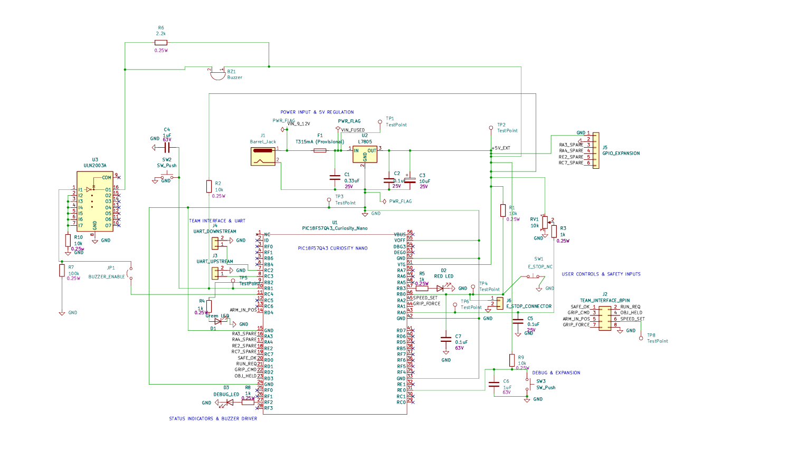

---
title: Schematic
---

# User Controls and Safety Subsystem

## Overview

This schematic describes the User Controls and Safety Subsystem of our robotic system. The subsystem uses a PIC18F57Q43 Curiosity Nano microcontroller to process user inputs, monitor stop-request signals, control status indicators, generate audible alerts, and communicate with other subsystems.

The main functional blocks include power regulation, emergency-stop monitoring, start/pause control, speed adjustment, LED indicators, a ULN2003A buzzer driver, communication interfaces, and debugging features.

## Complete Schematic — Revision B

**Figure 1:** Updated schematic of the User Controls and Safety Subsystem.

[View High-Resolution Schematic](EGR304_User_Controls_Schematic_RevB.pdf)

## Circuit Architecture

### 1. Power Regulation

The circuit receives an external 9–12 V DC supply through J1, a barrel jack connector.

F1 provides provisional overcurrent protection. U2, an L7805 linear voltage regulator, produces the regulated 5 V power rail.

C1, C2, and C3 provide input and output filtering to support voltage stability.

The final fuse rating and thermal performance will be verified during hardware implementation.

### 2. Microcontroller

The PIC18F57Q43 Curiosity Nano is the main controller.

It reads user inputs through digital GPIO and ADC connections, generates control signals, operates status indicators, and communicates with other robotic subsystems.

A custom KiCad symbol and footprint were created for the Curiosity Nano development board.

### 3. Emergency-Stop Monitoring

SW1 is a normally closed emergency-stop switch.

R1 provides a pull-up resistor, while C7 provides RC input filtering.

When SW1 opens, RB0 is pulled HIGH, allowing the microcontroller to detect a stop request.

J6 allows the physical switch to be connected externally.

This circuit monitors stop requests but does not replace an independent, safety-rated hardware shutdown system.

### 4. Start/Pause and Speed Control

SW2 provides the start/pause input.

R2 and C4 form a pull-up and RC debounce circuit.

RV1 is a 10 kΩ potentiometer used to adjust the requested operating speed.

R3 and C5 filter the analog voltage before it reaches RA0.

The microcontroller processes the input and can generate a speed command through RA2 using the SPEED_SET signal.

### 5. Status Indicators

Green and red LEDs provide visual operating-state indications.

Each LED uses a current-limiting resistor to prevent excessive current.

An additional debug LED supports circuit testing.

### 6. ULN2003A Buzzer Driver

The buzzer driver was updated from an individual 2N3904 transistor to a ULN2003A Darlington driver IC following instructor feedback.

The microcontroller sends the buzzer control signal from RC4 through JP1 to the first input channel of U3.

The corresponding ULN2003A output channel switches the buzzer's low-side connection.

The driver input circuitry provides defined logic states and supports external load control.

The selected passive piezoelectric buzzer requires an appropriate varying drive signal. The PWM waveform, actual drive voltage, and sound output will be verified during hardware testing.

### 7. Team Communication

J2 provides an eight-pin interface with the other robotic subsystems.

The interface includes SAFE_OK, RUN_REQ, GRIP_CMD, OBJ_HELD, ARM_IN_POS, SPEED_SET, GRIP_FORCE, and GND.

J3 and J4 provide additional UART communication connections.

### 8. Debugging and Expansion

SW3 provides an additional debug input.

J5 offers power, ground, and spare GPIO connections for future expansion.

Test points are included to support voltage measurements and signal verification during circuit testing.

## Design Revision

**Revision A:** Initial schematic using a 2N3904 transistor for buzzer switching.

**Revision B:** Updated buzzer driver using a ULN2003A driver IC in response to instructor feedback.

The revised schematic passed KiCad Electrical Rules Checker with zero errors and zero warnings.

Physical testing and final component verification remain future implementation tasks.

## Resources

- [Download Schematic RevB PDF](EGR304_User_Controls_Schematic_RevB.pdf)
- [Download KiCad Project RevB ZIP](EGR304_User_Controls_Project_RevB.zip)
- [View Schematic RevB PNG](Schematic_RevB.png)
