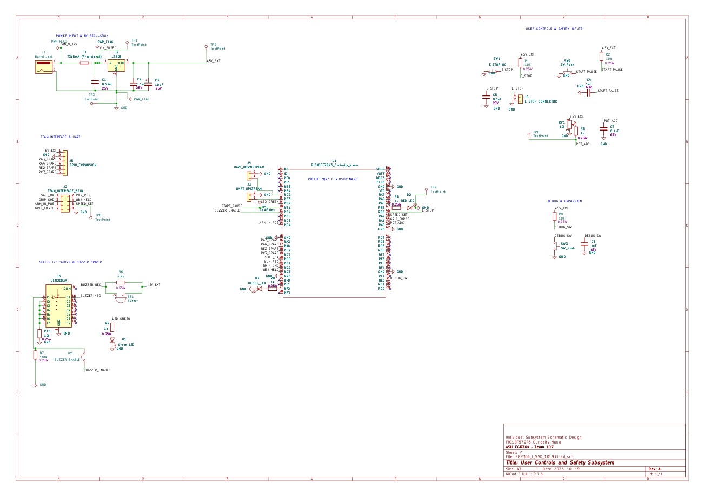

---
title: Schematic
---

# User Controls and Safety Subsystem

## Overview

This schematic describes the User Controls and Safety Subsystem of our robotic system. The subsystem uses a PIC18F57Q43 Curiosity Nano microcontroller to process user inputs, monitor emergency-stop requests, control status indicators, generate audible alerts, and communicate with other robotic subsystems.

The main functional blocks include power regulation, emergency-stop monitoring, start/pause control, speed adjustment, LED indicators, a ULN2003A buzzer driver, communication interfaces, and debugging and expansion features.

The schematic has been reorganized using descriptive net labels to improve readability, simplify signal tracing, and reduce unnecessary wiring across the drawing.

## Complete Schematic — Revision C

**Figure 1:** Revised schematic of the User Controls and Safety Subsystem, including the updated buzzer driver and reorganized signal connections.

[View High-Resolution Schematic](EGR304_User_Controls_Schematic_RevC.pdf)

## Circuit Architecture

### 1. Power Regulation

The circuit receives an external 9–12 V DC supply through J1, a barrel jack connector.

F1 provides overcurrent protection, while U2, an L7805 linear voltage regulator, generates the regulated +5V_EXT supply rail.

C1, C2, and C3 provide input and output filtering to improve voltage stability.

The PIC18F57Q43 Curiosity Nano is powered through its USB connection, while the external circuitry uses the regulated +5V_EXT supply. The two circuits share a common ground reference.

The final fuse rating, regulator thermal performance, and power consumption will be verified during hardware implementation.

### 2. Microcontroller

The PIC18F57Q43 Curiosity Nano serves as the main controller for the subsystem.

It reads user inputs through digital GPIO and ADC connections, generates control outputs, operates status indicators, and communicates with other robotic subsystems.

A custom KiCad symbol and footprint were created for the Curiosity Nano development board.

Descriptive net labels connect the microcontroller to the other functional blocks, improving the organization and readability of the schematic.

### 3. Emergency-Stop Monitoring

SW1 is a normally closed emergency-stop switch.

R1 provides a pull-up resistor, while C5 provides input filtering.

Under normal conditions, the switch holds the E_STOP signal LOW. When the switch opens, the signal is pulled HIGH.

The E_STOP signal is connected to RB0 of the microcontroller, allowing the firmware to detect a stop request.

J6 provides an external connection for the physical emergency-stop switch.

This circuit provides stop-request monitoring but does not replace an independent, safety-rated hardware shutdown system.

### 4. Start/Pause and Speed Control

SW2 provides the start/pause input.

R2 and C4 form a pull-up and RC filtering circuit for the START_PAUSE signal, which is connected to RB1.

RV1 is a 10 kΩ potentiometer used to adjust the requested operating speed.

The potentiometer generates an adjustable analog voltage. R3 and C7 provide filtering before the POT_ADC signal reaches RA0, which is configured as an ADC input.

The microcontroller processes the analog speed request and can generate a corresponding speed command through RA2 using the SPEED_SET signal.

POT_ADC and SPEED_SET are separate signals: POT_ADC represents the user's speed adjustment input, while SPEED_SET provides the speed command to the connected subsystem.

### 5. Status Indicators

Green and red LEDs provide visual indications of system operating conditions.

Each LED includes a current-limiting resistor to prevent excessive current.

The green LED is controlled through RB2, while the red LED is controlled through RB3.

An additional debug LED is connected through RF2 to support circuit testing and troubleshooting.

### 6. ULN2003A Buzzer Driver

The original buzzer circuit used an individual 2N3904 transistor. Following instructor feedback, the circuit was updated to use a ULN2003A Darlington driver IC.

The microcontroller generates the BUZZER_ENABLE control signal through RC4.

JP1 provides a connection between the control signal and the first input channel of U3.

The corresponding ULN2003A output channel provides low-side switching for the buzzer.

The input circuitry includes a pull-down resistor to establish a defined logic state when the control signal is disconnected.

Unused input channels are also connected to a defined LOW state.

The final buzzer drive method, operating voltage, and audible output will be verified against the selected component's datasheet during hardware testing.

### 7. Team Communication

J2 provides an eight-pin interface for communication with the other robotic subsystems.

The interface includes the following signals:

SAFE_OK

RUN_REQ

GRIP_CMD

OBJ_HELD

ARM_IN_POS

SPEED_SET

GRIP_FORCE

GND

The SPEED_SET signal is generated through the microcontroller's RA2 output, while GRIP_FORCE is connected to RA1 for analog measurement.

J3 and J4 provide additional UART communication interfaces using the microcontroller's RC3 and RC2 connections.

These connectors allow the user-control subsystem to exchange operating commands and status information with the other subsystems.

### 8. Debugging and Expansion

SW3 provides an additional debugging input through the DEBUG_SW signal, connected to RE0.

The debug input includes a pull-up resistor and an RC filtering capacitor.

J5 provides access to the external 5 V supply, ground, and spare GPIO connections for future expansion.

Test points are included at selected circuit nodes to support voltage measurements, debugging, and signal verification during hardware testing.

These features improve the flexibility and maintainability of the subsystem during development.

## Design Revision

**Revision A:** Initial schematic using a 2N3904 transistor for buzzer switching.

**Revision B:** Updated buzzer driver using a ULN2003A driver IC in response to instructor feedback.

**Revision C:** Reorganized the schematic using descriptive net labels, separated functional circuit blocks, and clarified microcontroller signal connections to improve readability and maintainability.

The revised schematic has passed KiCad Electrical Rules Check (ERC).

Physical testing, final component verification, and system-level validation remain part of the hardware implementation process.

## Resources

- [Download Schematic RevB PDF](EGR304_User_Controls_Schematic_RevC.pdf)
- [Download KiCad Project RevB ZIP](EGR304_User_Controls_Project_RevC.zip)
- [View Schematic RevB PNG](Schematic_RevC.png)
