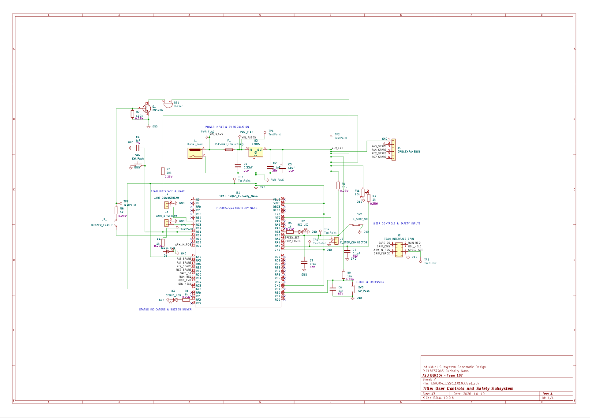

---
title: Schematic
---

## Overview

This schematic represents the User Controls and Safety Subsystem for our robotic arm project. The subsystem is designed around the PIC18F57Q43 Curiosity Nano microcontroller and provides user input, status indication, and communication with other subsystems.

The major functions include:

- **Power Regulation:** A 9–12 V DC input is regulated to 5 V using an L7805 voltage regulator.
- **Emergency Stop Input:** A normally closed (NC) switch provides an emergency-stop request signal to the microcontroller.
- **Start/Pause Control:** A push button allows the user to request operation or pause.
- **Speed Adjustment:** A 10 kΩ potentiometer provides an adjustable analog input through an RC filter.
- **Status Indicators:** Green and red LEDs indicate system operating states.
- **Buzzer Driver:** A 2N3904 transistor drives a 5 V buzzer for audible notifications.
- **Communication Interface:** UART connectors and an 8-pin interface support communication with the other robotic arm subsystems.
- **Debug and Expansion:** Additional test points, a debug button, and GPIO connections support testing and future development.

## Complete Schematic

**Figure 1:** Complete schematic of the User Controls and Safety Subsystem, including the power supply, PIC18F57Q43 Curiosity Nano, user inputs, indicators, buzzer driver, and communication interfaces.

[View full-size schematic image](SchematicPNG.png)

## Design Notes

The circuit includes RC filtering for mechanical switch inputs and the speed adjustment potentiometer.

The emergency-stop switch is monitored by the microcontroller. This input circuit is intended for prototype-level stop-request detection and does not replace an independent hardware safety shutdown circuit.

The fuse rating is provisional, and the peripheral IC requirement is pending instructor confirmation.

## Resources

- [Download Schematic PDF](EGR304_I_SSD_1019.pdf)
- [Download KiCad Project ZIP](EGR304_User_Controls_Schematic_RevA.zip)
- [View Schematic PNG](SchematicPNG.png)

The KiCad project archive includes the schematic, project configuration, and custom symbol and footprint libraries.
