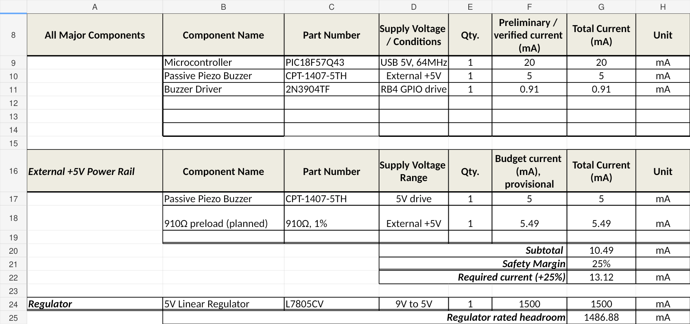
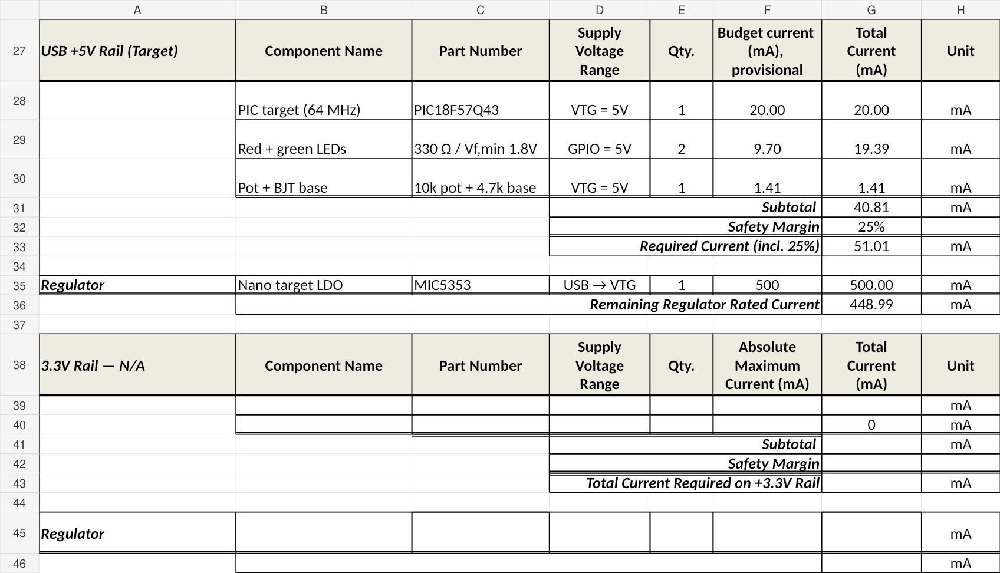
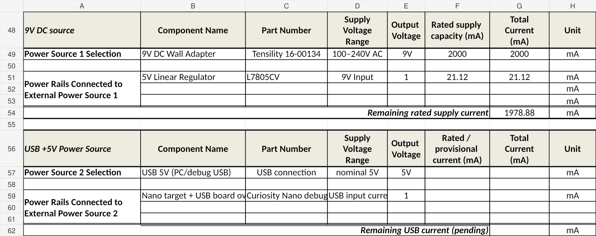
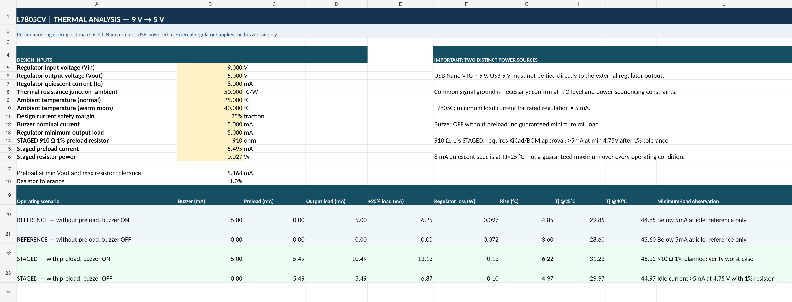

---
title: Power Budget
---

## Overview

The purpose of this power budget is to evaluate the
electrical power requirements of the User Controls
& Safety subsystem.

This subsystem includes a PIC18F57Q43 microcontroller,
emergency stop and start/pause buttons, a speed control
potentiometer, status indicator LEDs, and an audible
warning buzzer.

According to the project requirements, the subsystem
uses a 9V external DC power supply and a 5V linear
voltage regulator.

The power budget will be used to estimate the maximum
current consumption of each component, determine the
total power requirements, and verify that the selected
voltage regulator and external power supply can safely
support the subsystem.

The calculations will also include a 25% current safety
margin and an evaluation of the voltage regulator's
power dissipation.

## Power Budget Calculations

### Component and Power Rail Analysis

### USB Power Rail

### External Power Sources

### Thermal Analysis

## Resources

The preliminary Power Budget report is available
for download:

- [Power Budget PDF](EGR304_Power_Budget_Preliminary.pdf)
- [Power Budget Excel](EGR304_Power_Budget_RevC_ULN2003A.xlsx)

**Status:** Preliminary Design —
Hardware Verification Pending.

## Conclusions

The final conclusions will be completed after the
power consumption, power supply capacity, and regulator
thermal calculations have been verified.

## Resources

The completed Power Budget PDF and Microsoft Excel
spreadsheet will be provided here.
