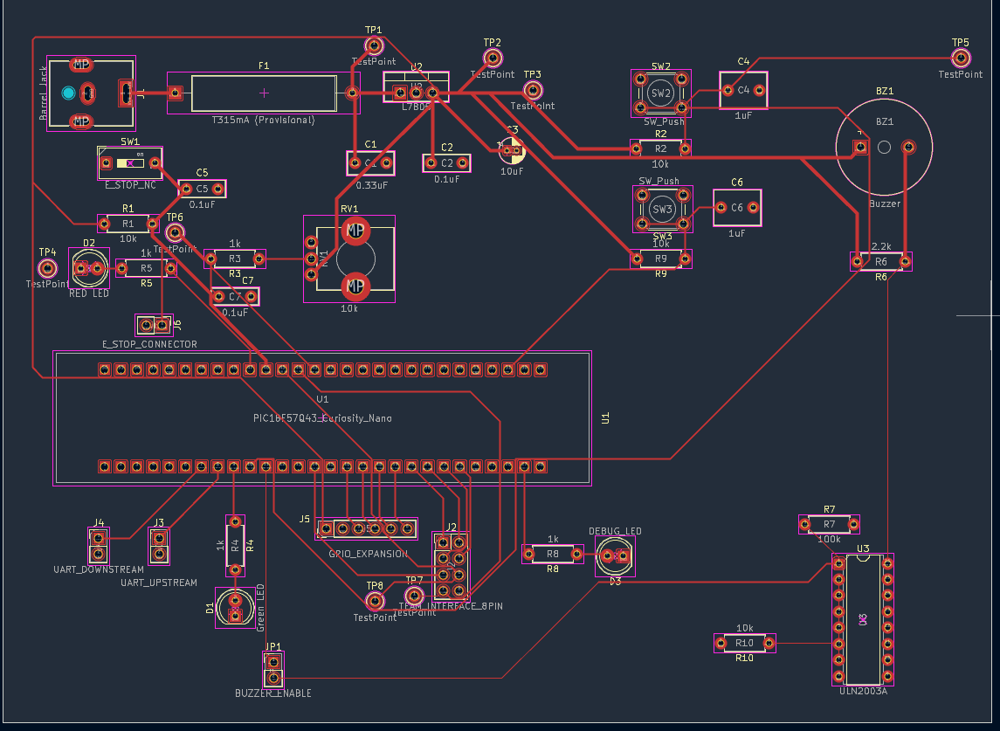
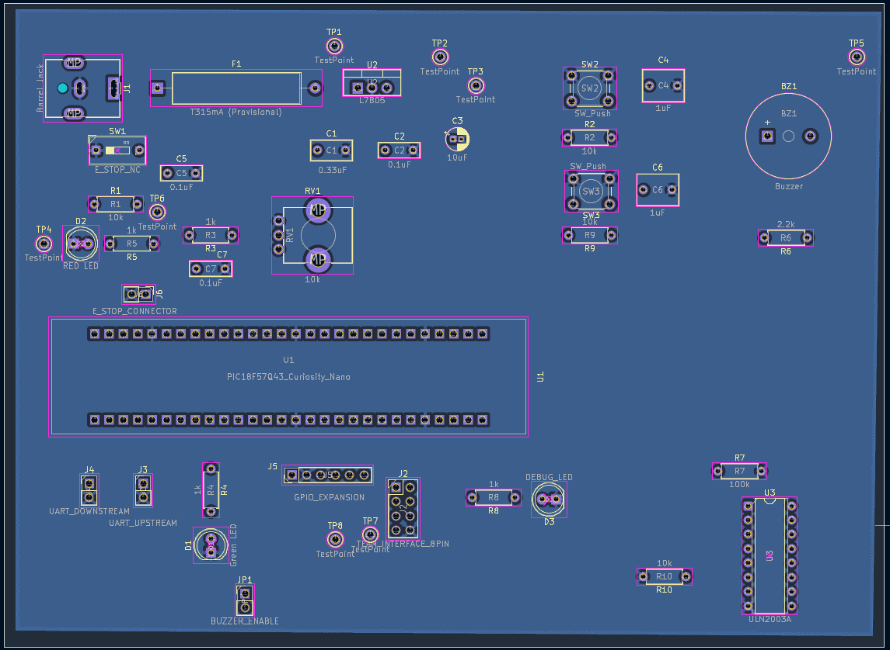
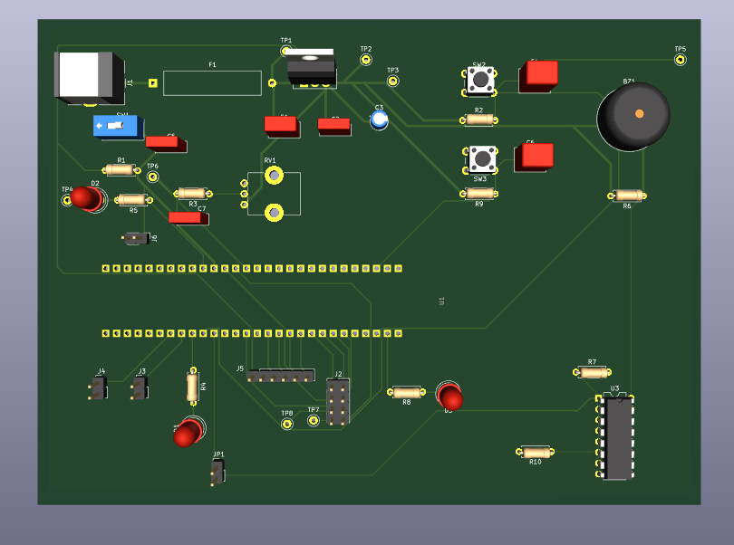
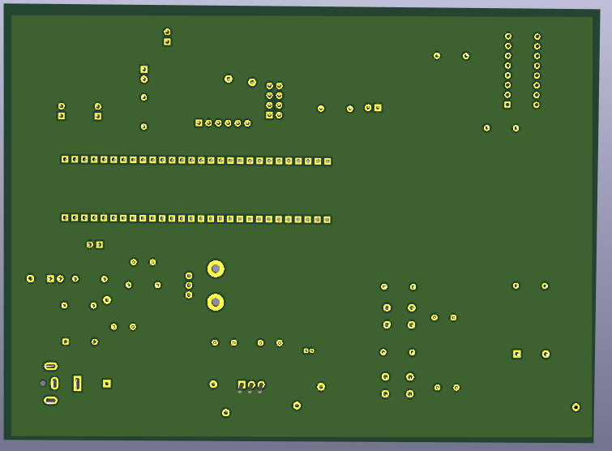
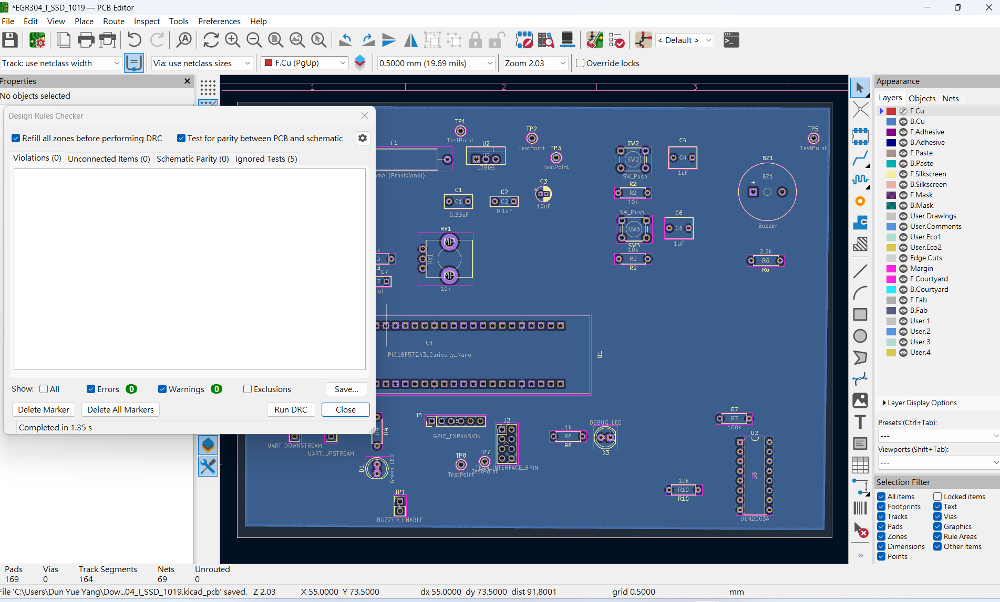
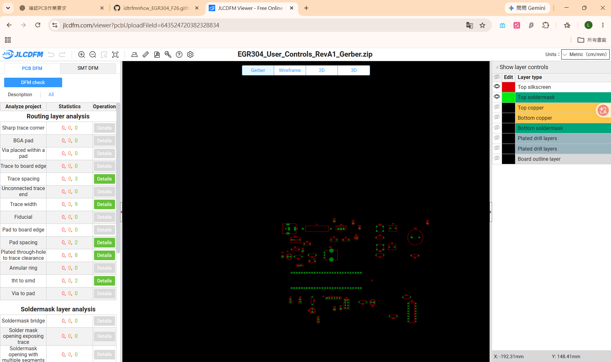
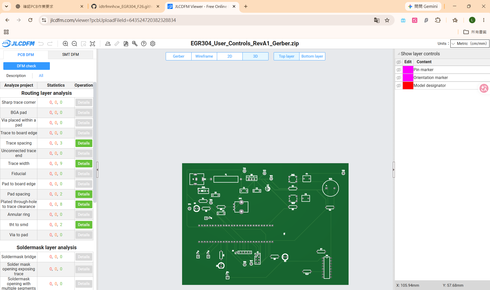
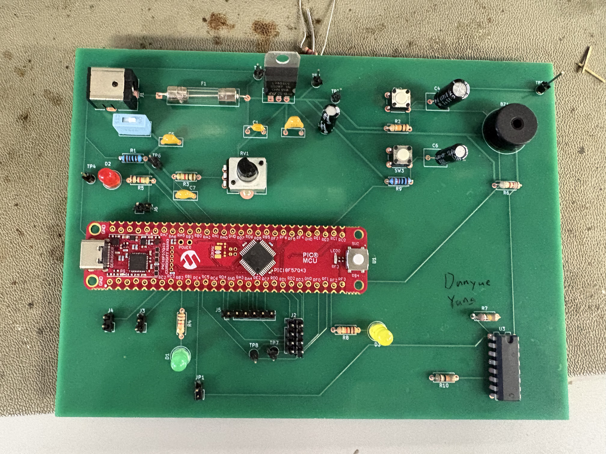
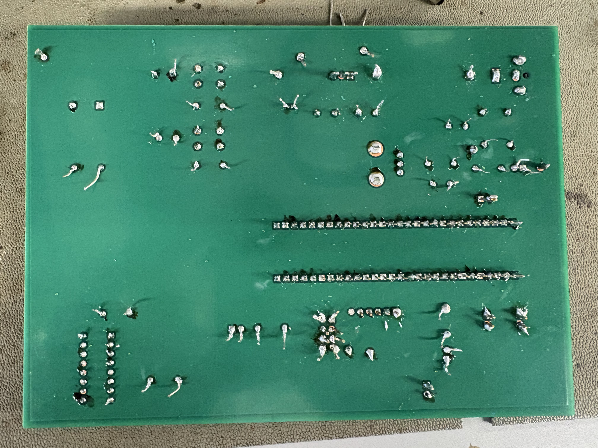

# PCB Design — Revision A.1

**Student:** Dun Yue Yang  
**Course:** EGR 304 — Embedded Systems Design  
**Design:** User Controls and Safety Subsystem  
**Current Revision:** A.1  
**Updated:** November 25, 2026  
**Status:** PCB Fabricated — Hardware Assembly and Subsystem Verification in Progress

---

## 1. Design Overview

This PCB was designed using KiCad 10.0 for the EGR 304 Embedded Systems Design project.

The design integrates a PIC18F57Q43 Curiosity Nano with supporting circuitry for power regulation, user controls, status indicators, buzzer control, and team communication.

The major functional sections include:

- **Power Supply:** DC barrel jack, fuse, L7805 voltage regulator, and filtering capacitors.
- **User Controls:** Emergency stop, start/pause buttons, and speed-adjustment potentiometer.
- **Status Indicators:** Green, red, and debugging LEDs.
- **Buzzer Driver:** ULN2003A driver circuit.
- **Team Interface:** Digital control signals, analog signals, and UART communication.
- **Debugging:** Dedicated test points for circuit verification.

---

## 2. PCB Layout

The PCB uses a two-layer design:

- **F.Cu:** Signal and power routing.
- **B.Cu:** Signal routing and GND copper zone.

The component placement and routing are organized according to the major functional sections of the circuit.

### Front Copper Layer (F.Cu)

[Download Front Copper Layout PDF](EGR304_I_SSDTop_RevA1_F_Cu.pdf)

### Back Copper Layer (B.Cu)

[Download Back Copper Layout PDF](EGR304_I_SSDBottom_RevA1_B_Cu.pdf)

A GND copper zone is implemented on the back copper layer.

---

## 3. PCB 3D Visualization

The KiCad 3D Viewer was used to inspect component placement, board geometry, and the overall mechanical arrangement.

### Top 3D View

### Bottom 3D View

---

## 4. Test Points

Test points are included to support debugging and verification of important power and control signals.

| Test Point | Net Name | Purpose |
|---|---|---|
| TP1 | VIN_FUSED | Fused input voltage |
| TP2 | +5V_EXT | Regulated 5V output |
| TP3 | GND | Ground reference |
| TP4 | GND | Ground reference |
| TP5 | START_PAUSE | Start/Pause control signal |
| TP6 | POT_ADC | Potentiometer ADC input |
| TP7 | GRIP_FORCE | Grip-force feedback signal |
| TP8 | SPEED_SET | Speed-setting DAC output |

TP7 was added in Revision A.1 to provide an additional measurement point for the GRIP_FORCE signal.

---

## 5. Design Verification

The following verification steps were completed after updating the PCB layout.

| Verification | Result |
|---|---|
| PCB Routing | Completed |
| B.Cu Ground Copper Zone | Completed |
| Design Rules Check (DRC) | 0 violations |
| Unconnected Items | 0 |
| PCB and Schematic Parity | Passed |
| 3D Model Inspection | Completed |

### Design Rules Check

The updated PCB layout passed the KiCad Design Rules Check with zero violations and zero unconnected items.

---

## 6. Design Files

The updated KiCad project is available below.

**[Download KiCad PCB Design — Revision A.1](EGR304_I_SSD_1109_RevA1.zip)**

### PCB Layout Documents

- [Front Copper Layout PDF — Revision A.1](EGR304_I_SSDTop_RevA1_F_Cu.pdf)
- [Back Copper Layout PDF — Revision A.1](EGR304_I_SSDBottom_RevA1_B_Cu.pdf)

---

## 7. Revision History

| Revision | Date | Description |
|---|---|---|
| A | November 6, 2026 | Initial completed PCB layout |
| A.1 | November 9, 2026 | Added TP7 for GRIP_FORCE and updated PCB documentation |

---

## 8. PCB Manufacturing Files

### Gerber and NC Drill Files

The Gerber and NC Drill files for PCB Revision A.1
have been generated using KiCad 10.0.

The manufacturing package includes:
- Top and bottom copper layers
- Top and bottom solder mask layers
- Top and bottom silkscreen layers
- PCB board outline
- Plated and non-plated drill files

[Download Gerber and NC Drill ZIP](EGR304_User_Controls_RevA1_Gerber.zip)

**Status:** PCB manufacturing completed.

The Gerber and NC Drill files are retained as the manufacturing reference for PCB Revision A.1.

The fabricated PCB is currently being assembled and evaluated through individual subsystem hardware verification.

---

## 9. JLCPCB DFM Verification

### DFM Check Results

The PCB manufacturing files were uploaded to
JLCDFM for manufacturability analysis.

The initial DFM check identified silkscreen-related
issues, including silkscreen-to-pad clearance
and silkscreen line width.

These issues remain under review.

### PCB 3D Inspection

The PCB was inspected using the JLCDFM 3D Viewer.

### Manufacturing Status

| Manufacturing Item | Status |
|---|---|
| PCB Design | Completed |
| KiCad Design Rules Check | Completed |
| Gerber and NC Drill Files | Generated |
| Initial JLCPCB DFM Analysis | Completed |
| PCB Manufacturing | Completed |
| Component Assembly | In Progress |
| Individual Hardware Verification | In Progress |
| Team Integration | Pending |

The PCB has been manufactured and received for physical assembly and testing.

The initial DFM analysis identified silkscreen-related warnings. These results are retained as part of the manufacturing documentation.

Final hardware functionality will be evaluated through subsystem verification.

---

---

## 10. Physical PCB Assembly

The fabricated PCB integrates the PIC18F57Q43 Curiosity Nano with the power regulation circuit, user controls, status indicators, buzzer driver, and team communication interfaces.

The physical assembly process includes component placement, polarity verification, soldering, and inspection of electrical connections.

### Assembled PCB — Top View

*Figure: Top view of the fabricated PCB showing the installed components and subsystem interfaces.*

### Assembled PCB — Bottom View

*Figure: Bottom view of the fabricated PCB showing through-hole solder joints and electrical connections.*

---

## 11. Power Supply Verification

The power supply verification evaluates the external DC input, fuse protection, regulated 5 V output, and common ground connections.

TP4 is used as the measurement ground reference after confirming continuity between TP3 and TP4.

### Power Verification Results

| Test | Measurement Points | Expected Result | Measured Result | Status |
|---|---|---|---|---|
| Fused Input Voltage | TP1 - TP4 | Applied DC input voltage | TBD | Pass |
| Regulated Output | TP2 - TP4 | Approximately 5 V | TBD | Pass |
| Ground Continuity | TP3 - TP4 | Continuity | TBD | Pass |
| Supply Short Check | TP2 - TP4 | No short circuit | TBD | Pass |
| Team Connector Ground | J2 GND - TP4 | Continuity | TBD | Pass |
| Nano Target Voltage | VTG - GND | Approximately 5 V | TBD | Pass |

Continuity and resistance measurements are performed with the external power supply and USB connection disconnected.

The measured results will be recorded following physical hardware verification.

---

## 12. Subsystem Functional Verification

The individual subsystem verification evaluates the physical implementation of the user controls, safety monitoring, speed adjustment, status indicators, and audible warning functions.

### Emergency Stop and Safety Control

| Test | Expected Result | Status |
|---|---|---|
| Normal E-Stop Condition | E_STOP signal LOW | Pending |
| Triggered E-Stop Condition | E_STOP signal HIGH | Pending |
| Safety Output | SAFE_OK changes according to the safety condition | Pending |
| Run Request | RUN_REQ is disabled during an E-Stop condition | Pending |

### Start/Pause Control

| Test | Expected Result | Status |
|---|---|---|
| SW2 Released | Digital input HIGH | Pending |
| SW2 Pressed | Digital input LOW | Pending |
| Run/Pause Command | Firmware updates the requested operating state | Pending |

### Speed Adjustment and Analog Verification

The potentiometer RV1 generates an adjustable analog input voltage for the RA0 ADC channel.

The microcontroller processes the speed request and generates an analog speed command through the RA2 DAC output.

| Test Point | Signal | Expected Result | Status |
|---|---|---|---|
| TP6 | POT_ADC | Adjustable analog voltage | Pending |
| TP7 | GRIP_FORCE | Analog feedback input | Pending |
| TP8 | SPEED_SET | Adjustable DAC output voltage | Pending |

### Buzzer Verification

The RC4 PWM output controls the ULN2003A driver circuit to generate an audible warning.

| Test | Expected Result | Status |
|---|---|---|
| PWM Frequency | Approximately 4 kHz | Pending |
| Buzzer Enabled | Audible warning | Pending |
| Buzzer Disabled | No audible warning | Pending |

The final subsystem verification results will be updated following physical testing and instructor evaluation.

### Physical Assembly Inspection

The following items are inspected during the hardware assembly process:

- Component placement and orientation
- LED and capacitor polarity
- L7805 voltage regulator orientation
- ULN2003A driver orientation
- Curiosity Nano alignment
- Connector installation
- Solder joint quality
- Possible solder bridges and electrical shorts
- Student identification on the PCB

### Revision A.1 Changes

- Added TP7 to the GRIP_FORCE signal.
- Updated the PCB layout and routing documentation.
- Regenerated the PCB layout PDFs and images.
- Retained the B.Cu ground copper zone.
- Maintained F.Cu as the primary signal and power routing layer.
- Repeated design verification after the modification.

---

---

## Current Status and Future Improvements

PCB Revision A.1 has progressed from the design and manufacturing stage to physical hardware assembly and individual subsystem verification.

The remaining work includes:

1. Completing component assembly and solder joint inspection.
2. Recording measured power supply voltages.
3. Verifying microcontroller programming and GPIO operation.
4. Testing emergency-stop and start/pause functionality.
5. Verifying ADC, DAC, and PWM operation.
6. Evaluating the team communication interface.
7. Completing the instructor-required subsystem check-off.
8. Integrating the subsystem with the other robotic subsystems.
9. Updating the schematic, PCB, and firmware documentation if hardware modifications are required.

The final hardware verification results will be documented after testing.

## Related Documentation

- [Individual Block Diagram](../01-Block-Diagram/)
- [Schematic](../04-Schematic/schematic.md)
- [MCC Configuration](../06-MCC-Configuration/index%20%281%29.md)
- [Team 107 Project Website](https://egr304-2026-f-107.github.io/EGR304-2026-F-107.github.io/)

