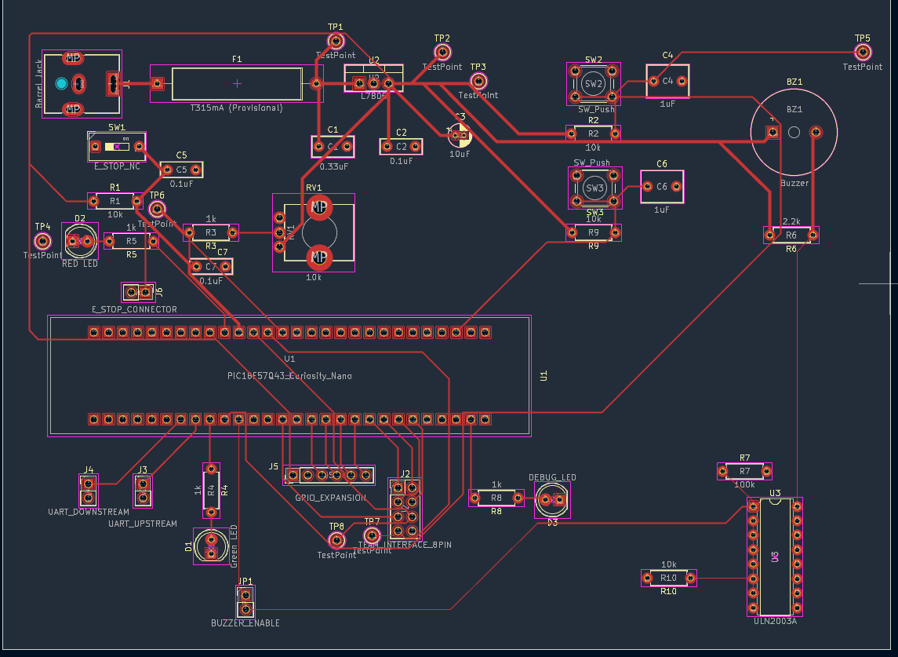
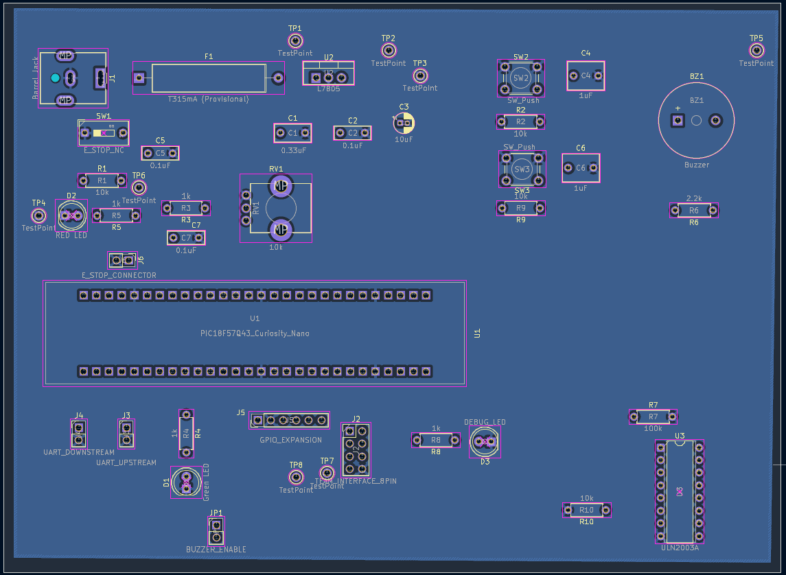
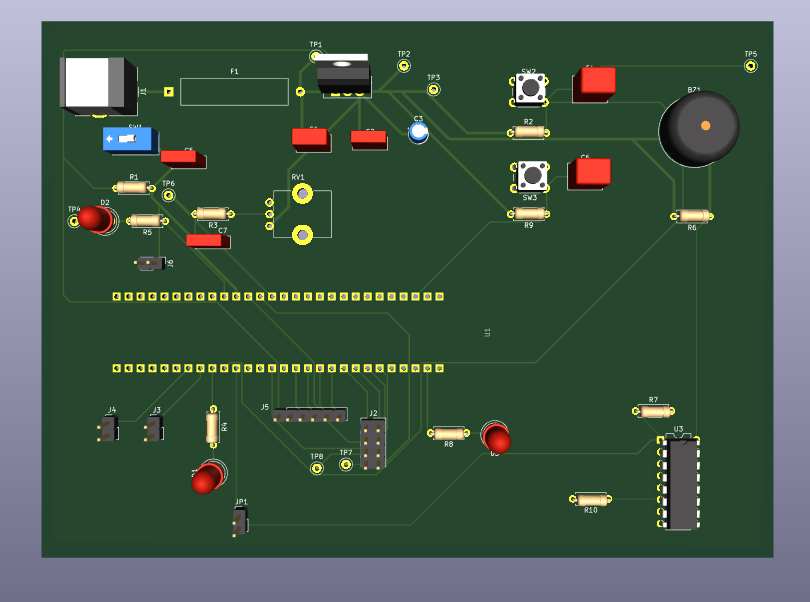
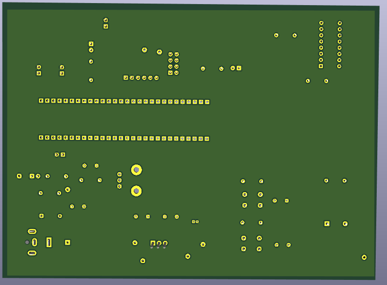
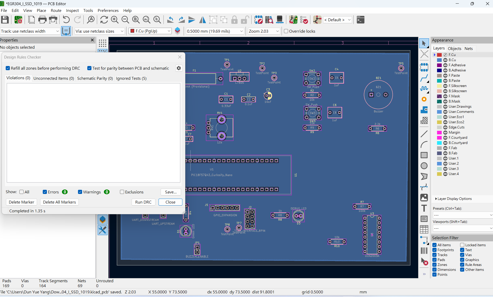

# PCB Design — Revision A.1

**Student:** Dun Yue Yang  
**Course:** EGR 304 — Embedded Systems Design  
**Design:** User Controls and Safety Subsystem  
**Current Revision:** A.1  
**Updated:** November 9, 2026  
**Status:** Updated Design — Pending Instructor and TA Feedback

---

## 1. Design Overview

This PCB was designed using KiCad 10.0 for the EGR 304 Embedded Systems Design project.

The design integrates a PIC18F57Q43 Curiosity Nano with supporting circuitry for power regulation, user controls, status indicators, buzzer control, and team communication.

The major functional sections include:

- **Power Supply:** DC barrel jack, fuse, L7805 voltage regulator, and filtering capacitors.
- **User Controls:** Emergency stop, start/pause buttons, and speed-adjustment potentiometer.
- **Status Indicators:** Green, red, and debugging LEDs.
- **Buzzer Driver:** ULN2003A driver circuit.
- **Team Interface:** Digital control signals, analog signals, and UART communication.
- **Debugging:** Dedicated test points for circuit verification.

---

## 2. PCB Layout

The PCB uses a two-layer design:

- **F.Cu:** Signal and power routing.
- **B.Cu:** Signal routing and GND copper zone.

The component placement and routing are organized according to the major functional sections of the circuit.

### Front Copper Layer (F.Cu)

[Download Front Copper Layout PDF](EGR304_I_SSDTop_RevA1_F_Cu.pdf)

### Back Copper Layer (B.Cu)

[Download Back Copper Layout PDF](EGR304_I_SSDBottom_RevA1_B_Cu.pdf)

A GND copper zone is implemented on the back copper layer.

---

## 3. PCB 3D Visualization

The KiCad 3D Viewer was used to inspect component placement, board geometry, and the overall mechanical arrangement.

### Top 3D View

### Bottom 3D View

---

## 4. Test Points

Test points are included to support debugging and verification of important power and control signals.

| Test Point | Net Name | Purpose |
|---|---|---|
| TP1 | VIN_FUSED | Fused input voltage |
| TP2 | +5V_EXT | Regulated 5V output |
| TP3 | GND | Ground reference |
| TP4 | GND | Ground reference |
| TP5 | START_PAUSE | Start/Pause control signal |
| TP6 | POT_ADC | Potentiometer ADC input |
| TP7 | GRIP_FORCE | Grip-force feedback signal |
| TP8 | SPEED_SET | Speed-setting DAC output |

TP7 was added in Revision A.1 to provide an additional measurement point for the GRIP_FORCE signal.

---

## 5. Design Verification

The following verification steps were completed after updating the PCB layout.

| Verification | Result |
|---|---|
| PCB Routing | Completed |
| B.Cu Ground Copper Zone | Completed |
| Design Rules Check (DRC) | 0 violations |
| Unconnected Items | 0 |
| PCB and Schematic Parity | Passed |
| 3D Model Inspection | Completed |

### Design Rules Check

The updated PCB layout passed the KiCad Design Rules Check with zero violations and zero unconnected items.

---

## 6. Design Files

The updated KiCad project is available below.

**[Download KiCad PCB Design — Revision A.1](EGR304_I_SSD_1109_RevA1.zip)**

### PCB Layout Documents

- [Front Copper Layout PDF — Revision A.1](EGR304_I_SSDTop_RevA1_F_Cu.pdf)
- [Back Copper Layout PDF — Revision A.1](EGR304_I_SSDBottom_RevA1_B_Cu.pdf)

---

## 7. Revision History

| Revision | Date | Description |
|---|---|---|
| A | November 6, 2026 | Initial completed PCB layout |
| A.1 | November 9, 2026 | Added TP7 for GRIP_FORCE and updated PCB documentation |

### Revision A.1 Changes

- Added TP7 to the GRIP_FORCE signal.
- Updated the PCB layout and routing documentation.
- Regenerated the PCB layout PDFs and images.
- Retained the B.Cu ground copper zone.
- Maintained F.Cu as the primary signal and power routing layer.
- Repeated design verification after the modification.

---

## 8. Future Improvements

Revision A.1 represents an updated PCB design prepared for instructor and TA review.

The board has not yet been manufactured or physically tested.

Future work includes:

1. Reviewing instructor and TA feedback.
2. Confirming component footprints and physical dimensions.
3. Verifying final component specifications.
4. Making any required PCB revisions.
5. Preparing manufacturing files after design approval.

**Current Status: Revision A.1 — Pending Instructor and TA Review.**
