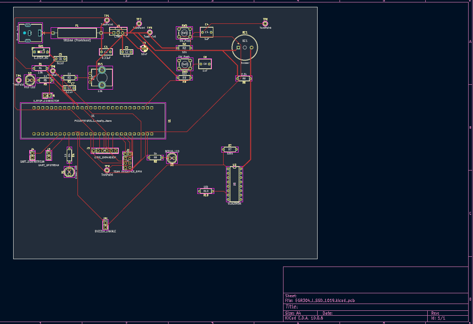
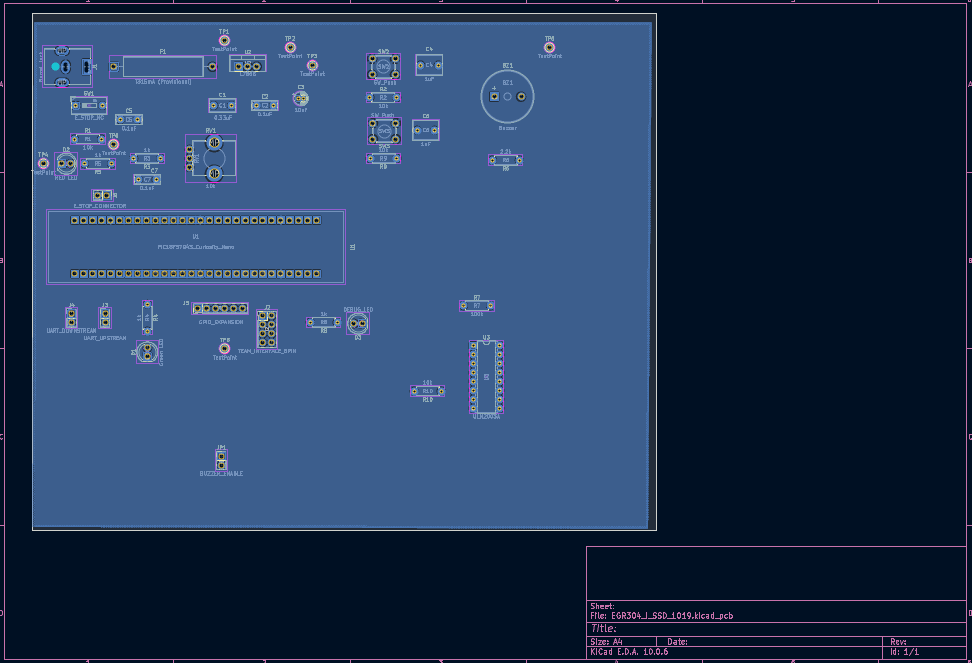
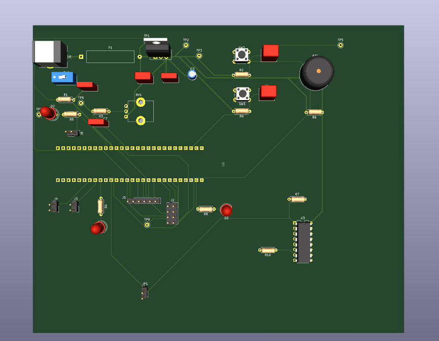
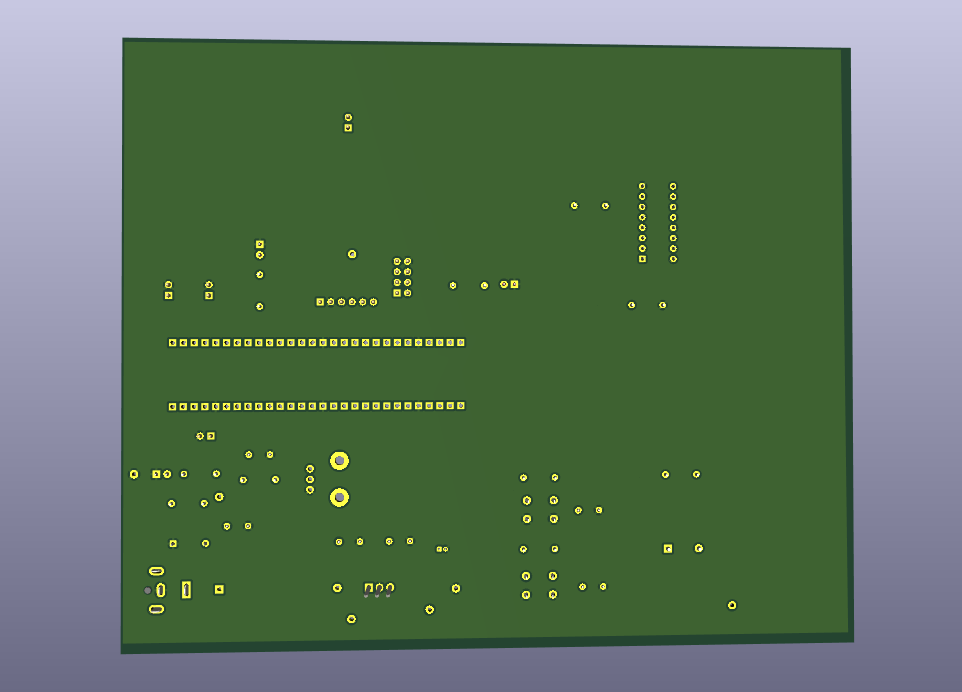
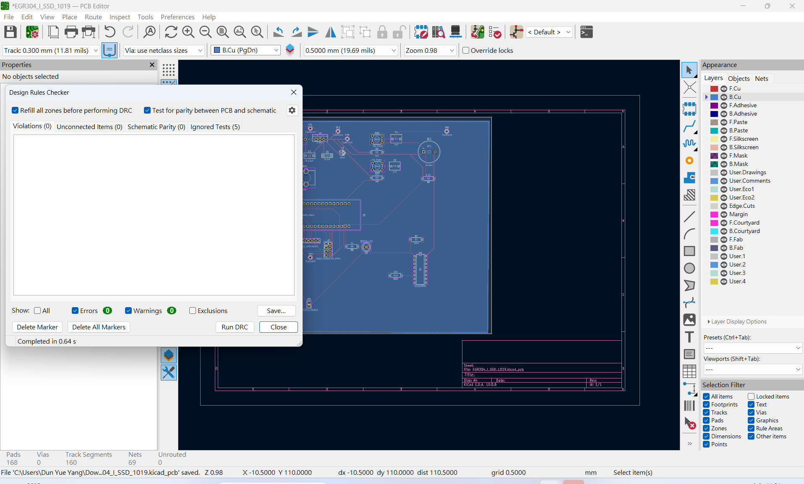

# PCB Design — Revision A

**Student:** Dun Yue Yang  
**Course:** EGR 304 — Embedded Systems Design  
**Design:** User Controls and Safety Subsystem  
**Revision:** A  
**Date:** November 6, 2026  
**Status:** Initial Design Review — Pending Instructor and TA Feedback

---

## 1. Design Overview

This PCB was designed using KiCad 10.0 for the EGR 304 Embedded Systems Design project.

The board integrates a PIC18F57Q43 Curiosity Nano with supporting circuitry for power regulation, user controls, status indicators, a buzzer driver, and external communication interfaces.

The major functional sections include:

- **Power Supply:** DC barrel jack, fuse, L7805 voltage regulator, and filtering capacitors.
- **User Controls:** Emergency stop, start/pause buttons, and speed-adjustment potentiometer.
- **Status Indicators:** Green, red, and debugging LEDs.
- **Buzzer Driver:** ULN2003A driver circuit for the buzzer.
- **Communication Interfaces:** UART connectors, team interface, and GPIO expansion.
- **Debugging:** Dedicated test points for circuit verification.

The initial PCB layout has been completed and is ready for instructor and TA review.

---

## 2. PCB Layout

The PCB was designed using a two-layer layout consisting of the front copper layer (F.Cu) and back copper layer (B.Cu).

Components were organized into functional groups to improve routing efficiency, accessibility, and readability.

### Front Copper Layer (F.Cu)

[Download Front Copper Layout PDF](EGR304_I_SSDTop_RevA_F_Cu.pdf)

### Back Copper Layer (B.Cu)

[Download Back Copper Layout PDF](EGR304_I_SSDBottom_RevA_B_Cu.pdf)

A ground copper zone was implemented on the back copper layer to provide the required GND connections.

---

## 3. PCB 3D Visualization

The KiCad 3D Viewer was used to inspect component placement, board geometry, and the overall mechanical arrangement.

### Top 3D View

### Bottom 3D View

---

## 4. Design Verification

The following verification steps were completed for Revision A:

| Verification | Result |
|---|---|
| PCB Routing | Completed |
| Ground Copper Zone | Completed |
| Design Rules Check (DRC) | 0 violations |
| Unconnected Items | 0 |
| PCB and Schematic Parity | Passed |
| 3D Model Inspection | Completed |

### Design Rules Check

The KiCad Design Rules Checker reported zero violations and zero unconnected items after completing the PCB routing and ground connections.

---

## 5. Design Files

The complete KiCad design project, including the schematic, PCB layout, project configuration, and custom footprint files, is provided below.

**[Download KiCad PCB Design — Revision A (ZIP)](EGR304_I_SSD_1106.zip)**

Additional layout documents:

- [Front Copper Layout PDF](EGR304_I_SSDTop_RevA_F_Cu.pdf)
- [Back Copper Layout PDF](EGR304_I_SSDBottom_RevA_B_Cu.pdf)

---

## 6. Revision Status and Future Improvements

Revision A represents the initial completed PCB layout prepared for design review.

The design has passed the completed KiCad verification checks. However, the PCB has not yet been manufactured or physically tested.

The next steps will include:

1. Obtaining feedback from the instructor and teaching assistants.
2. Reviewing component footprints and physical clearances.
3. Confirming final component specifications and fuse selection.
4. Making any required schematic or PCB revisions.
5. Preparing the final manufacturing files after design approval.

**Current Status: Revision A — Pending Instructor and TA Review.**
